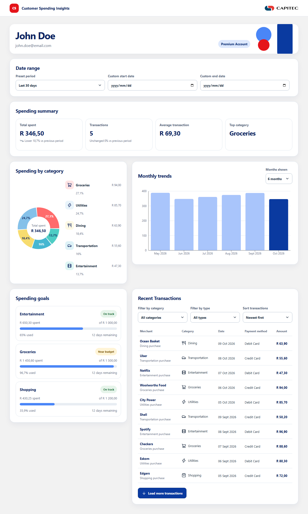
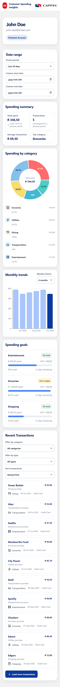
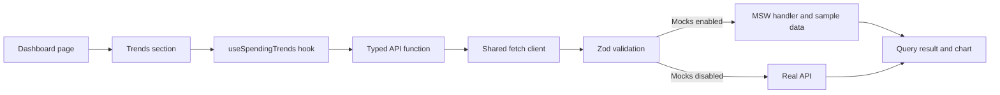

# Customer Spending Insights

Customer Spending Insights is a responsive React and TypeScript dashboard for exploring one customer's spending profile, trends, goals, categories, and transactions. It uses the existing Vite, Zod, MSW, Vitest, Docker, and Nginx setup. The default image includes realistic mock data and does not need a backend.

| Desktop (1280px)                                                  | Mobile (375px)                                                                            |
| ----------------------------------------------------------------- | ----------------------------------------------------------------------------------------- |
|  |  |

## Quick start

With Docker Engine and the Docker Compose plugin installed:

```sh
git clone https://github.com/Kurt-van-Reenen/effective-succotash.git
cd effective-succotash
docker compose up --build
```

Open <http://localhost:8080>. The page loads sample spending insights for customer `12345`. Stop the foreground service with `Ctrl+C`.

## Guided walkthrough

Follow the monthly spending trend from the screen to the response:

1. [`DashboardPage.tsx`](./src/features/spending/DashboardPage.tsx) places the seven sections and owns the selected preset and custom date values.
2. [`TrendsSection.tsx`](./src/features/spending/TrendsSection.tsx) renders the months selector and chart, and calls `useSpendingTrends(months)`.
3. [`hooks.ts`](./src/features/spending/hooks.ts) creates a query key and calls the endpoint API function.
4. [`api.ts`](./src/features/spending/api.ts) builds the customer endpoint URL and calls the shared JSON client.
5. [`client.ts`](./src/api/client.ts) fetches the response and validates its shape using the endpoint's Zod schema in [`types.ts`](./src/api/types.ts).
6. In the default build, MSW intercepts the request in [`handlers.ts`](./src/mocks/handlers.ts) and computes its response from deterministic API-shaped data in [`spending.ts`](./src/mocks/data/spending.ts). With mocks disabled, the request reaches the configured real API.
7. The validated trends return through TanStack Query to the component, which renders the chart and its accessible data table.



## Project structure

```text
.
├── .github/workflows/ci.yml       # Lint, format, coverage, build, Docker build, browser tests
├── docs/screenshots/              # README screenshots (npm run screenshots)
├── e2e/                           # Playwright browser tests at mobile, tablet, and desktop widths
├── public/mockServiceWorker.js    # MSW browser worker
├── src/
│   ├── api/                       # Shared endpoint schemas, inferred types, fetch client
│   ├── assets/                    # Images imported by components (bundled and hashed)
│   ├── features/spending/         # Dashboard sections, endpoint hooks, API and formatters
│   ├── mocks/data/spending.ts     # Replaceable sample customer, goals and transactions
│   ├── mocks/handlers.ts          # Query-aware MSW endpoint behavior
│   ├── styles/tokens.css          # Theme colors, spacing, radii, and type scale
│   └── test/                      # Vitest and MSW test setup
├── Dockerfile
├── docker-compose.yml
├── nginx.conf                     # CSP placeholder filled from VITE_ASSET_BASE_URL at Docker build
└── vite.config.ts
```

## Design tokens

All theme colors, spacing, radii, and font sizes are CSS custom properties in [`tokens.css`](./src/styles/tokens.css). Change a token there to update its use across the dashboard; component layout and behavior stay in the feature CSS Module at [`Dashboard.module.css`](./src/features/spending/Dashboard.module.css). The interface uses a system font stack and makes no external font requests. Assets are self-hosted unless a CDN is configured (see [Serving assets from a CDN](#serving-assets-from-a-cdn)).

The dashboard is mobile-first. Sections sit side by side from 768px, and transactions are stacked cards below 1024px and a table from 1024px up, the width at which all five columns fit without clipping the amount. Focus indicators and text labels accompany state colors. The dashboard is tested against WCAG 2.2 AA (see [Testing](#testing)), and each chart has an accessible text alternative: a screen-reader table for the monthly trends and a text legend for the categories.

## Configuration

| Variable              | Default | Description                                                                                                 |
| --------------------- | ------- | ----------------------------------------------------------------------------------------------------------- |
| `VITE_ENABLE_MOCKS`   | `true`  | Starts MSW and includes its browser worker when true. Set false for a real API build.                       |
| `VITE_API_BASE_URL`   | `/api`  | API origin/base path; the app appends `/customers/{customerId}/...`.                                        |
| `VITE_CUSTOMER_ID`    | `12345` | Customer identifier used in every endpoint path.                                                            |
| `VITE_ASSET_BASE_URL` | `/`     | Where bundled JS, CSS, and images are loaded from. Set to an `https://` CDN URL to serve assets from a CDN. |

Copy `.env.example` to `.env` to configure a Compose build. Vite variables are baked into the frontend at build time; changing a running container's environment does not change the bundle. Do not put secrets in `VITE_` variables because they are public in the browser.

## Switching from mock data to a real API

Build and run with a real API base URL:

```sh
docker build --build-arg VITE_ENABLE_MOCKS=false --build-arg VITE_API_BASE_URL=https://api.example.com/api --build-arg VITE_CUSTOMER_ID=12345 -t customer-spending:real-api .
docker run --rm -p 8080:8080 customer-spending:real-api
```

The API must implement the seven endpoints in the supplied Customer Spending Insights API contract and return responses matching the schemas in [`types.ts`](./src/api/types.ts). It must allow CORS from the dashboard origin. When using Compose, set `VITE_ENABLE_MOCKS=false`, `VITE_API_BASE_URL=https://api.example.com/api`, and `VITE_CUSTOMER_ID=12345` in `.env`, then run `docker compose up --build`.

To use local mock responses again, set `VITE_ENABLE_MOCKS=true` and `VITE_API_BASE_URL=/api` in `.env`, then rebuild with `docker compose up --build`.

## Serving assets from a CDN

Images live in [`src/assets/`](./src/assets/) and are imported by components, so Vite bundles them with the JS and CSS. Category icons come from `lucide-react` and are part of the JS bundle, and small decorative SVGs are inlined in CSS as `data:` URIs. Put new images in `src/assets/` and import them rather than using `public/`, so they pick up hashed filenames and the CDN prefix.

Assets are self-hosted by default. Every bundled file under `dist/assets/` has a content-hashed name, and Nginx already serves `/assets/` with a one-year cache, so the container can act as the CDN's origin as-is.

To switch to a CDN, build with its URL:

```sh
docker build --build-arg VITE_ASSET_BASE_URL=https://cdn.example.com/ -t customer-spending:cdn .
```

This rewrites asset URLs in `index.html` and the bundle, and adds the CDN origin to the CSP's `script-src`, `style-src`, and `img-src`. Then:

- Point the CDN at this container (or upload `dist/assets/` to the matching path).
- The CDN must send `Access-Control-Allow-Origin` for the dashboard origin, because Vite loads module scripts with `crossorigin`.
- `index.html` and `mockServiceWorker.js` always stay on the dashboard origin; service workers cannot be cross-origin.

## API and mock behavior

The shared API client is the only code that calls `fetch`; it rejects non-success responses and validates every successful response before UI components receive it. The category and transaction color fields must be six-digit hex values before they can be used as chart or icon colors.

The deterministic mock contains 60 transactions across six categories and the last 12 calendar months. The handlers derive category summaries, period summaries, monthly trends, and filtered/sorted/paginated transactions from this data. The endpoint handlers honor presets, custom dates, category, payment method, sort order, limit, and offset where those parameters are defined.

### Assumptions

- A custom start/end date overrides the selected preset for category spending and transactions. The summary endpoint accepts only `period`, so its cards continue to use the selected preset while custom dates are active.
- The custom end date is inclusive. A start date later than the end date blocks category and transaction requests and displays a validation message.
- Trends are grouped by calendar month and do not use the custom filter, because the trends endpoint accepts only a month count. The sample history contains at most 12 months, so a 24-month request returns all available seeded months.
- The dashboard extends the contract with an optional `paymentMethods` string array on the filters response and an optional `paymentMethod` parameter on the transactions endpoint. The mock implements both. A backend that follows the contract alone can omit `paymentMethods`; the transaction type filter is then hidden and `paymentMethod` is never sent.
- Goals are displayed as monthly budgets; the endpoint has no date or period parameter.
- The transaction endpoint has no period parameter. With no explicit custom dates, it returns transactions from the full seeded history.
- The API's `percentageUsed` controls each goal's progress; the bar is capped visually at 100%, while the displayed percentage retains the API value.
- Known goal statuses are `on_track`, `warning`, and `over_budget`; any other value is shown with a neutral “Status unavailable” badge.
- The customer profile's currency drives money formatting. ZAR is used until a profile response is available.
- The `en-ZA` locale is used for currency and date formatting. Date-only values are interpreted in UTC to avoid timezone-dependent day changes.

## Content Security Policy

Nginx retains a restrictive same-origin script policy and the existing worker directives for MSW. The one additional relaxation is `style-src 'unsafe-inline'`: Recharts' responsive chart layout and the dashboard's validated API-driven category/progress styles require inline style attributes. No inline-script permission or external font source is enabled; a CDN origin is added only when `VITE_ASSET_BASE_URL` is an external URL. The existing `connect-src 'self' https:` allowance supports HTTPS API endpoints when mocks are disabled.

## Development

Prerequisites for local development are Node.js 24.15+ in the 24.x line and npm 11+. Docker builds use Node.js 24.18.0 and an unprivileged Nginx runtime.

```sh
npm ci
npm run dev        # Vite dev server with mocks enabled, at http://localhost:5173
npm run build      # Type-check and produce the production bundle in dist/
npm run docker:up  # Same as docker compose up --build
```

`npm run format` applies Prettier formatting.

## Testing

The project has two test layers:

- **Unit and component tests** (Vitest, React Testing Library, MSW) in `src/**/*.test.ts(x)`. Components are rendered against the same mock handlers the browser uses, and individual tests override endpoints to cover failures, empty states, and invalid responses.
- **Browser tests** (Playwright) in [`e2e/`](./e2e/). These load the production build in Chromium at mobile (375px), tablet (768px), and desktop (1280px) widths. They check that every section renders, nothing scrolls horizontally, transactions switch from cards to a table at 1024px and the table never needs sideways scrolling, the charts draw and stay inside their containers, and the page loads with no console errors or blocked resources. An [axe](https://github.com/dequelabs/axe-core) scan checks the loaded dashboard and the invalid date range state against WCAG 2.2 level A and AA at every width; a failure lists each rule, the affected elements, and a link explaining the fix.

Run the checks locally:

```sh
npm test               # Unit and component tests
npm run test:watch     # Re-run unit tests on change
npm run test:coverage  # Unit tests with a coverage report in coverage/index.html
npm run test:e2e       # Browser tests against a fresh production build
npm run lint
npm run format:check
npm run typecheck
```

Before the first browser test run, download Chromium with `npx playwright install chromium`. To run the browser tests against an app that is already running, such as the Docker container, set `PLAYWRIGHT_BASE_URL` (for example `PLAYWRIGHT_BASE_URL=http://localhost:8080 npm run test:e2e`).

The coverage run fails if statements or lines drop below 85%, or branches or functions below 75%. Chart rendering callbacks are not reachable in jsdom, which has no layout, so the browser tests cover them instead.

Run the unit tests in Docker, with no local Node.js needed:

```sh
docker build --target test -t customer-spending-test .
```

The build fails if any test fails. On every push and pull request, CI runs lint, format check, unit tests with coverage, a production build, and a Docker image build. It then starts that image and runs the browser tests against it, so the production Nginx headers and Content Security Policy are tested too. Coverage and (on failure) Playwright reports are uploaded as workflow artifacts.

`npm run screenshots` regenerates the images at the top of this README.

## Error handling

Each section loads independently, so a failed endpoint shows a retryable message in that section while the others keep working. Customers see a plain-language message; the technical detail (status code, URL, schema error) is logged to the browser console. An error boundary around the dashboard catches unexpected render errors and offers a reload instead of a blank page.
