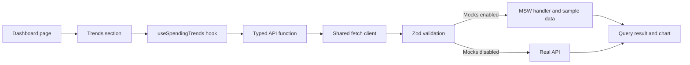

# Customer Spending Insights

Customer Spending Insights is a responsive React and TypeScript dashboard for exploring one customer's spending profile, trends, goals, categories, and transactions. It uses the existing Vite, Zod, MSW, Vitest, Docker, and Nginx setup. The default image includes realistic mock data and does not need a backend.

## Quick start

With Docker Engine and the Docker Compose plugin installed:

```sh
git clone https://github.com/Kurt-van-Reenen/effective-succotash.git
cd effective-succotash
docker compose up --build
```

Open <http://localhost:8080>. The page loads sample spending insights for customer `12345`. Stop the foreground service with `Ctrl+C`.

## Guided walkthrough

Follow the monthly spending trend from the screen to the response:

1. [`DashboardPage.tsx`](./src/features/spending/DashboardPage.tsx) places the seven sections and owns the selected preset and custom date values.
2. [`TrendsSection.tsx`](./src/features/spending/TrendsSection.tsx) renders the months selector and chart, and calls `useSpendingTrends(months)`.
3. [`hooks.ts`](./src/features/spending/hooks.ts) creates a query key and calls the endpoint API function.
4. [`api.ts`](./src/features/spending/api.ts) builds the customer endpoint URL and calls the shared JSON client.
5. [`client.ts`](./src/api/client.ts) fetches the response and validates its shape using the endpoint's Zod schema in [`types.ts`](./src/api/types.ts).
6. In the default build, MSW intercepts the request in [`handlers.ts`](./src/mocks/handlers.ts) and computes its response from deterministic API-shaped data in [`spending.ts`](./src/mocks/data/spending.ts). With mocks disabled, the request reaches the configured real API.
7. The validated trends return through TanStack Query to the component, which renders the chart and its accessible data table.



## Project structure

```text
.
├── .github/workflows/ci.yml       # Lint, format check, tests, app build, Docker build
├── public/mockServiceWorker.js    # MSW browser worker
├── src/
│   ├── api/                       # Shared endpoint schemas, inferred types, fetch client
│   ├── features/spending/         # Dashboard sections, endpoint hooks, API and formatters
│   ├── mocks/data/spending.ts     # Replaceable sample customer, goals and transactions
│   ├── mocks/handlers.ts          # Query-aware MSW endpoint behavior
│   ├── styles/tokens.css          # Theme colors, spacing, radii, and type scale
│   └── test/                      # Vitest and MSW test setup
├── Dockerfile
├── docker-compose.yml
├── nginx.conf
└── vite.config.ts
```

## Design tokens

All theme colors, spacing, radii, and font sizes are CSS custom properties in [`tokens.css`](./src/styles/tokens.css). Change a token there to update its use across the dashboard; component layout and behavior stay in the feature CSS Module at [`Dashboard.module.css`](./src/features/spending/Dashboard.module.css). The interface uses a system font stack and makes no external font or CDN requests.

The dashboard is mobile-first: transaction rows become stacked cards on narrow screens, and the layout expands to two-column tablet and multi-column desktop sections. Focus indicators and text labels accompany state colors.

## Configuration

| Variable            | Default | Description                                                                           |
| ------------------- | ------- | ------------------------------------------------------------------------------------- |
| `VITE_ENABLE_MOCKS` | `true`  | Starts MSW and includes its browser worker when true. Set false for a real API build. |
| `VITE_API_BASE_URL` | `/api`  | API origin/base path; the app appends `/customers/{customerId}/...`.                  |
| `VITE_CUSTOMER_ID`  | `12345` | Customer identifier used in every endpoint path.                                      |

Copy `.env.example` to `.env` to configure a Compose build. Vite variables are baked into the frontend at build time; changing a running container's environment does not change the bundle. Do not put secrets in `VITE_` variables because they are public in the browser.

## Switching from mock data to a real API

Build and run with a real API base URL:

```sh
docker build --build-arg VITE_ENABLE_MOCKS=false --build-arg VITE_API_BASE_URL=https://api.example.com/api --build-arg VITE_CUSTOMER_ID=12345 -t customer-spending:real-api .
docker run --rm -p 8080:8080 customer-spending:real-api
```

The API must implement the seven endpoints in the supplied Customer Spending Insights API contract and return responses matching the schemas in [`types.ts`](./src/api/types.ts). It must allow CORS from the dashboard origin. When using Compose, set `VITE_ENABLE_MOCKS=false`, `VITE_API_BASE_URL=https://api.example.com/api`, and `VITE_CUSTOMER_ID=12345` in `.env`, then run `docker compose up --build`.

To use local mock responses again, set `VITE_ENABLE_MOCKS=true` and `VITE_API_BASE_URL=/api` in `.env`, then rebuild with `docker compose up --build`.

## API and mock behavior

The shared API client is the only code that calls `fetch`; it rejects non-success responses and validates every successful response before UI components receive it. The category and transaction color fields must be six-digit hex values before they can be used as chart or icon colors.

The deterministic mock contains 60 transactions across six categories and the last 12 calendar months. The handlers derive category summaries, period summaries, monthly trends, and filtered/sorted/paginated transactions from this data. The endpoint handlers honor presets, custom dates, category, sort order, limit, and offset where those parameters are defined.

### Assumptions

- A custom start/end date overrides the selected preset for category spending and transactions. The summary endpoint accepts only `period`, so its cards continue to use the selected preset while custom dates are active.
- The custom end date is inclusive. A start date later than the end date blocks category and transaction requests and displays a validation message.
- Trends are grouped by calendar month and do not use the custom filter, because the trends endpoint accepts only a month count. The sample history contains at most 12 months, so a 24-month request returns all available seeded months.
- Goals are displayed as monthly budgets; the endpoint has no date or period parameter.
- The transaction endpoint has no period parameter. With no explicit custom dates, it returns transactions from the full seeded history.
- The API's `percentageUsed` controls each goal's progress; the bar is capped visually at 100%, while the displayed percentage retains the API value.
- Known goal statuses are `on_track`, `warning`, and `over_budget`; any other value is shown with a neutral “Status unavailable” badge.
- The customer profile's currency drives money formatting. ZAR is used until a profile response is available.
- The `en-ZA` locale is used for currency and date formatting. Date-only values are interpreted in UTC to avoid timezone-dependent day changes.

## Content Security Policy

Nginx retains a restrictive same-origin script policy and the existing worker directives for MSW. The one additional relaxation is `style-src 'unsafe-inline'`: Recharts' responsive chart layout and the dashboard's validated API-driven category/progress styles require inline style attributes. No inline-script permission or external font/CDN source is enabled. The existing `connect-src 'self' https:` allowance supports HTTPS API endpoints when mocks are disabled.

## Development and verification

Prerequisites for local development are Node.js 24.15+ in the 24.x line and npm 11+. Docker builds use Node.js 24.18.0 and an unprivileged Nginx runtime.

```sh
npm ci
npm test
npm run lint
npm run format:check
npm run build
```

`npm run dev` starts Vite with mocks enabled by default. `npm run format` applies Prettier formatting. To run the test suite in the Docker test stage, use `docker build --target test -t customer-spending-test .`. CI runs lint, format check, tests, a production build, and a Docker image build.
